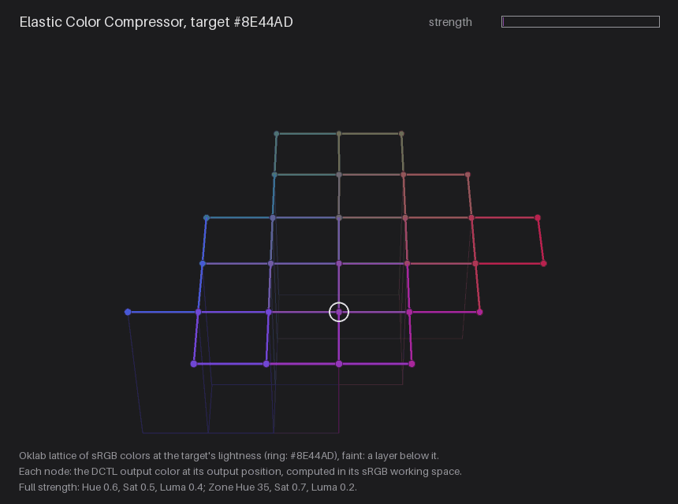
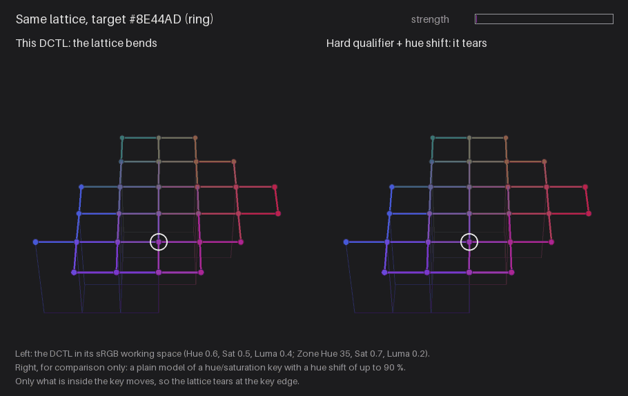
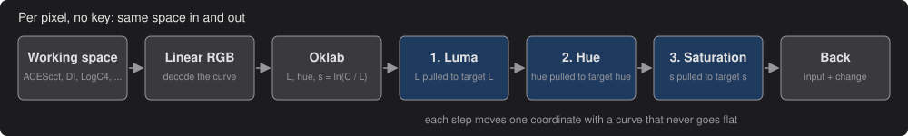

# Elastic Color Compressor

An elastic color compressor for DaVinci Resolve, written as a single DCTL file.



*A lattice of colors bending toward the target `#8E44AD` (ring) as the strength rises: the pull fades with distance, greys stay put, and the lattice bends but never folds. Computed by the DCTL; see [In pictures](#in-pictures).*

Pick a target color (a brand color, a product, a sky) and colors near it are pulled toward it in hue, saturation and lightness, like a color compressor, but with smooth elastic curves instead of a key. There are no masks or qualifiers: neighboring colors move together, so a gradient stays a gradient (no inversions, no steps, no banding), and an exposure ramp stays an exposure ramp. Work happens in Oklab. A soft "zone weight" can also be written to the alpha channel.

The target is entered in a color picker as the **hex value the color must have in the delivered master**, so a brand hex can be pasted directly. In an ACES 2.0 pipeline the node computes, with the inverse ACES 2.0 Output Transform, the scene color that the Output Transform renders to that hex, and pulls colors toward it.

## Install

DCTL effects require **DaVinci Resolve Studio**. The color picker and the alpha output need Resolve 19.1 or later.

1. Download `ElasticColorCompressor.dctl` from the [latest GitHub Release](https://github.com/maxlainz/elastic-color-compressor/releases/latest).
2. Copy it into Resolve's LUT folder (or a subfolder of it). In Resolve, *Project Settings > Color Management > Lookup Table > Open LUT Folder* opens it. Default locations:

   | OS | Path |
   |---|---|
   | macOS | `/Library/Application Support/Blackmagic Design/DaVinci Resolve/LUT` |
   | Windows | `C:\ProgramData\Blackmagic Design\DaVinci Resolve\Support\LUT` |
   | Linux | `/opt/resolve/LUT` |

3. In Resolve, press *Update Lists* in the same Project Settings page, or restart Resolve.
4. Use the **ResolveFX DCTL** plugin. On the Color page, add a node and open *OpenFX > ResolveFX Color > DCTL*, then pick `ElasticColorCompressor` in the plugin's DCTL list.

## Working spaces

Set *Working Space* to the space in which the node receives its pixels. Input and output are always in the same space.

| Working Space | Use it for |
|---|---|
| ACEScct (default) | ACES pipelines, grading between IDT and ODT. Preferred over ACEScc in ACES |
| ACEScc | ACES pipelines using ACEScc |
| DaVinci Intermediate | DaVinci Wide Gamut / DaVinci Intermediate timelines (RCM) |
| ARRI LogC4 | ARRI LogC4 / AWG4 material without a transform |
| Rec.709 Gamma 2.4 | Timelines without color management, clips already in Rec.709 (display-referred) |
| sRGB | Same, with the sRGB transfer function |

If the timeline is in another space, wrap the node with a Color Space Transform. The node cannot detect which space it receives; a wrong space moves the wrong colors.

The **Target Color** is interpreted by *Target Output*, independently of the working space:

| Target Output | The picker values are | Use it for |
|---|---|---|
| ACES 2.0 SDR Rec.709 (default) | Display code values of the ACES 2.0 SDR 100-nit Output Transform on a Rec.709 BT.1886 (gamma 2.4) display: OCIO display `Rec.1886 Rec.709 - Display`, view `ACES 2.0 - SDR 100 nits (Rec.709)` | ACES pipelines delivering a Rec.709 master |
| ACES 2.0 SDR sRGB | The same Output Transform encoded for an sRGB display: OCIO display `sRGB - Display`, same view | ACES pipelines delivering an sRGB (web) master |
| None - node code values | Code values in the node's own working space | Rec.709 Gamma 2.4 or sRGB timelines without color management, where the node output is the delivered master |

With the two ACES 2.0 options, the target is the scene color that the ACES 2.0 Output Transform renders to the hex, computed with the inverse Output Transform; it is converted to the working space like any pixel. With *None*, the hex is decoded with the working space's own transfer function and primaries.

## Quick start

1. **Set the target.** Click the *Target Color* swatch and paste the hex value (on macOS the hex field of the color dialog is in its RGB sliders panel). Set *Target Output* to the master you deliver (see [Working spaces](#working-spaces)).
2. **See the zone.** Temporarily turn on *Output Zone Alpha* and view the alpha with Resolve's **Highlight** (Shift+H) and *Use OFX Alpha* on the node. Adjust *Zone Hue Range*, *Zone Sat Range* and *Zone Luma Range* until the zone covers the colors you want to pull. Turn *Output Zone Alpha* off again before grading (see [Limitations](#limitations)).
3. **Pull.** Raise *Hue Compress* first, then *Sat Compress*. *Luma Compress* is off by default: it pulls lightness toward the target's lightness and is the strongest move.
4. **Blend.** Use *Mix* to back the whole effect off.

Always test with a continuous hue ramp and an exposure ramp as well as real footage: there must be no steps.

## Parameters

Controls are grouped top to bottom: *Working Space*, **Target** (color and output), **Compress** (how hard each axis is pulled), **Zone** (which colors are pulled), then *Mix*, *Output Zone Alpha* and *Show Target*.

| Control | Default | Range | What it does |
|---|---|---|---|
| Working Space | ACEScct | see above | Input and output space. Only changes the conversion to and from Oklab. |
| **Target Color** | #003087 | color picker | The color others are pulled toward, as the hex it must have in the delivered master. |
| **Target Output** | ACES 2.0 SDR Rec.709 | ACES 2.0 SDR Rec.709, ACES 2.0 SDR sRGB, None - node code values | What the hex is: display code values of the ACES 2.0 SDR 100-nit Output Transform (Rec.709 BT.1886 or sRGB display), or code values in the working space. See [Working spaces](#working-spaces). |
| **Hue Compress** | 0.5 | 0-0.99 | How strongly hue is pulled toward the target hue. |
| **Sat Compress** | 0.3 | 0-0.99 | How strongly saturation is pulled toward the target's saturation. |
| **Luma Compress** | 0 | 0-0.99 | How strongly Oklab lightness is pulled toward the target's lightness. |
| **Zone Hue Range deg** | 25 | 3-120 | Width of the zone around the target hue. Wider = more hues pulled, gentler per hue. |
| **Zone Sat Range** | 0.7 | 0.1-3 | Width of the zone around the target saturation, in natural-log units of chroma / lightness (0.7 = roughly half to double). |
| **Zone Luma Range** | 0.25 | 0.02-1 | Width of the zone around the target lightness (Oklab L). Shapes the luma pull and the zone alpha only. |
| Mix | 1.0 | 0-1 | Scales all three strengths. Mix 0 returns the input. |
| Output Zone Alpha | off | checkbox | Writes the **zone weight** (where the compressor acts, 0 to 1) to alpha, multiplied by the input alpha. Off = the input alpha passes through. For viewing the zone only. |
| Show Target | off | checkbox | Fills the whole frame with the target color, in the working space. Through the Output Transform it shows the color the target renders to: use it to check the delivered hex (see below). |

Compress 0.99 is the maximum: at 1.0 the curve would flatten to a step and posterize.

## Certifying the brand color

With *Target Output* on an ACES 2.0 option, a pixel of exactly the target color renders to the hex: the target is the scene value that the ACES 2.0 SDR 100-nit Output Transform turns into the hex (`tools/verify.py` checks this against OpenColorIO 2.6 over an 8-bit grid of the cube and typical brand colors: within 0.02/255, except the two regions listed in [Limitations](#limitations)). The compressor only pulls colors *toward* the target; it does not snap anything onto it. For the hex to come out in the master:

1. **The node must be the last grade before the Output Transform.** Any node after it (a look, a grade, a film emulation) moves the color again.
2. **Resolve's output must be the same transform:** ACES 2.0, SDR 100 nits, Rec.709 limiting primaries, with the Rec.709 BT.1886 (gamma 2.4) display for *ACES 2.0 SDR Rec.709* or the sRGB display for *ACES 2.0 SDR sRGB*. HDR outputs are not implemented: with an HDR output the target is still the scene color defined by the SDR transform, which renders to a different value in HDR.
3. **Check the result in Resolve.** Turn on *Show Target*: the frame becomes the target color, through the rest of the pipeline. Render it in the delivery format and read the code values of the file (or Resolve's color picker / a scope on the output). They should be the hex. That render is the final check; the numerical tests do not replace it. Turn *Show Target* off again. (Checked in DaVinci Resolve Studio 21.1 on macOS: the render through ACES 2.0 SDR Rec.709 returns the hex exactly.)

## Compared with Resolve's Color Compressor

DaVinci Resolve Studio ships a ResolveFX *Color Compressor* with similar controls (Target Color, Compress Hue / Saturation / Luminance). According to the Resolve manual (*Resolve FX Color* chapter), it moves the hue, saturation and luminance of every pixel toward the target by a fixed fraction: 0.5 is halfway, 1.0 makes every color identical to the target. It is a contrast reduction of each channel around the target as pivot, applied to the whole frame, and the manual recommends isolating the object with a qualifier or window first. That design has consequences this DCTL avoids:

| | Resolve Color Compressor | Elastic Color Compressor |
|---|---|---|
| Which colors move | All of them by the same fraction; a qualifier or window limits it | Only colors near the target, fading smoothly with distance: no key needed |
| Edges | The qualifier's edge: inside moves, outside does not, so a gradient across it gets a step | No key, no edge (see the comparison animation in [In pictures](#in-pictures)) |
| Hue | A fixed fraction toward the target cannot be continuous all around the hue circle: it must break at the hue opposite the target | Periodic attractor: smooth all around the circle, verified monotonic |
| Greys | Saturation moves toward the target's, so greys inside the selection take on color | Greys never move |
| Target | Picked in the timeline's color space | The hex as delivered: exact through the ACES 2.0 SDR Output Transform |
| Strength 1.0 | Every color becomes the target: texture is lost | Capped at 0.99: colors bunch toward the target but keep their order and texture |

The fraction-toward-the-target behavior and the qualifier recommendation are from the manual; the hue and grey consequences follow from that behavior, not from measurements of Resolve's plugin.

## How it works

### In pictures

Every effect shown here (and in the animation at the top) is computed by the DCTL itself, run in its sRGB working space with *Target Output* `None - node code values`, so code values are shown directly as sRGB, with the target `#8E44AD`. Regenerate with `python3 tools/make_figures.py`.



The same lattice side by side with a plain model of a hard key plus a hue shift. The key moves only what is inside it, so the lattice tears at its edge: in a picture, a gradient through that edge gets a step.



### Step by step

```
working space -> linear RGB -> XYZ (D65) -> Oklab (L, a, b) -> (L, h, s) with s = ln(C / L)
  1. luma        L -> L'   weight from hue and saturation
  2. hue         h -> h'   weight from saturation
  3. saturation  s -> s'   weight from the new hue h'
-> change in Oklab -> linear RGB (input + change) -> working space
```

Each axis uses the same attractor curve, with x the distance to the target in units of its range:

```
x' = x - strength * x * exp(-x^2 / 2)
```

It pulls hardest near the target and fades to the identity far from it. On the hue circle the periodic version `sin(d) * exp((cos d - 1) / w^2)` is used, so there is no seam at 180 degrees.

Saturation is measured as `s = ln(C / L)` (chroma relative to lightness) rather than chroma: hue and `s` do not change with exposure, so the color change is the same at every exposure and an exposure ramp comes out as an exposure ramp.

The result is applied as a **change** added to the input (not rebuilt from scratch): where nothing moves the change is exactly 0, and greys (chroma 0) never move.

## Design guarantees

These are the invariants the code is written and verified against (`tools/verify.py`):

- **No inversions, no folds.** Each step changes one coordinate with a curve whose slope is at least `1 - strength > 0`, weighted only by coordinates that step does not change. Each step is invertible, so the whole map is: neighboring colors never swap order. Verified as a positive Jacobian determinant over random settings across the full UI ranges, in every working space.
- **Exposure ramps stay exposure ramps.** Along `k * rgb` the output luminance strictly increases and the output chromaticity stays constant.
- **Greys never move**, whatever the target or strength.
- **The target is a fixed point**: a pixel of exactly the target color is not changed, for every *Target Output*.
- **Mix 0 and strengths 0 return the input** (to the float32 round trip of the transfer curve).
- **No hard masks.** Every weight is a smooth (C-infinity) field. The only branches are on UI parameters, the published transfer-function segments, and the `C > 0` guard of `atan2`.
- **Alpha is the zone weight**: a smooth field in [0, 1], 1 at the target, multiplied by the input alpha.

## Limitations

- **Output Zone Alpha changes the picture in Resolve.** Resolve can use a plugin's alpha downstream, so with it on, the graded image changes. It is off by default; use it only to look at the zone.
- Per pixel: the node does not know what the target object is, only its color. Anything with a similar color is pulled too; narrow the ranges or use a window.
- The working space is chosen by hand; the node cannot detect the space of its input.
- The target is entered as display code values 0-1 of the chosen output: a color outside the Rec.709 / sRGB display gamut cannot be entered with the ACES 2.0 options.
- HDR output transforms are not implemented: the ACES 2.0 options define the target with the SDR 100-nit transform, whatever output is used.
- Two regions of the hex cube do not reach the 0.02/255 certification tolerance, for reasons in the ACES 2.0 transform itself, and match the hex only as well as OpenColorIO's own inverse does: colors within 3 codes of white, white excluded (up to 0.32/255: the tonescale is nearly flat at the top, and the inverse Output Transform, OpenColorIO's as well as this one, misses them), and, on the Rec.709 BT.1886 display only, colors with a channel below 12/255 (up to 1/255 in code values, below 2e-5 of white in linear light: BT.1886 is a pure 2.4 power, so float32 noise near black is amplified in code values).
- ACEScc is not invertible below linear 0: the official encoding sends every linear value <= 0 to the floor -0.3584. A pixel below the floor does not come back bit-for-bit, and a move that pushes a channel negative is flattened at the floor. ACEScct has a linear segment below 0 and does not have this problem: prefer ACEScct in ACES pipelines.
- Rec.709 Gamma 2.4 is a pure mirrored power: encoding has infinite slope at 0, so tiny linear values around black give visible codes. sRGB has a linear toe and does not suffer from it.
- Below Oklab L 0.01 (deep below black) saturation is measured against a lightness floor of 0.01.
- Far from the target the move fades smoothly but is not exactly zero until the kernels underflow; with the defaults a color of the opposite hue moves less than 1e-5 code values.
- Always verify by eye: no numerical test replaces looking at real footage and ramps on a monitor.

## Development

```
python3 tools/verify.py            # must end in ALL OK (requires numpy, opencolorio 2.6 and a C++17 compiler)
python3 tools/gen_matrices.py      # prints the matrix blocks pasted into the DCTL (only if a primary, white or CAT changes)
python3 tools/gen_aces2_tables.py  # prints the ACES 2.0 constants and tables pasted into the DCTL
python3 tools/make_figures.py      # regenerates the README figures in docs/img/ (also requires Pillow)
```

- `tools/verify.py` compiles the DCTL itself as C++ through a small prelude that maps the DCTL built-ins to `<cmath>`, once in float32 and once in float64, and runs every check on that code: UI spec, matrices, ACES 2.0 tables, transfer curves, identity, greys, target fixed point, exposure ramps, Jacobian determinant, alpha, and the ACES 2.0 certification of the target against OpenColorIO. There is no hand-written model to keep in sync. It runs in CI in a few seconds.
- `tools/gen_aces2_tables.py` is a port of the init code of the ACES 2.0 CTL (parameters, reach, cusp and upper hull gamma tables) for the SDR 100-nit Rec.709-limited transform. Its output is pasted into the DCTL; `verify.py` detects any mismatch.
- `tools/gen_matrices.py` derives each space's `RGB -> XYZ(D65)` matrix (primaries normalized per SMPTE RP 177 + Bradford) and the Oklab matrices. Its output is pasted into the DCTL; `verify.py` detects any mismatch.
- Gotchas of DCTL UI parameters: labels in `DEFINE_UI_PARAMS` must not contain parentheses or commas. `Resolve.ValidateDCTL` only parses the UI parameters, so a broken kernel can pass it; real compilation happens when the node loads in Resolve.

See [docs/design-notes.md](docs/design-notes.md) for the reasoning behind the design choices.

## Contributing

Issues and pull requests are welcome; see [CONTRIBUTING.md](CONTRIBUTING.md).

## License

GPL-3.0-or-later. Copyright (C) 2026 Max Lainz. See [LICENSE](LICENSE).
